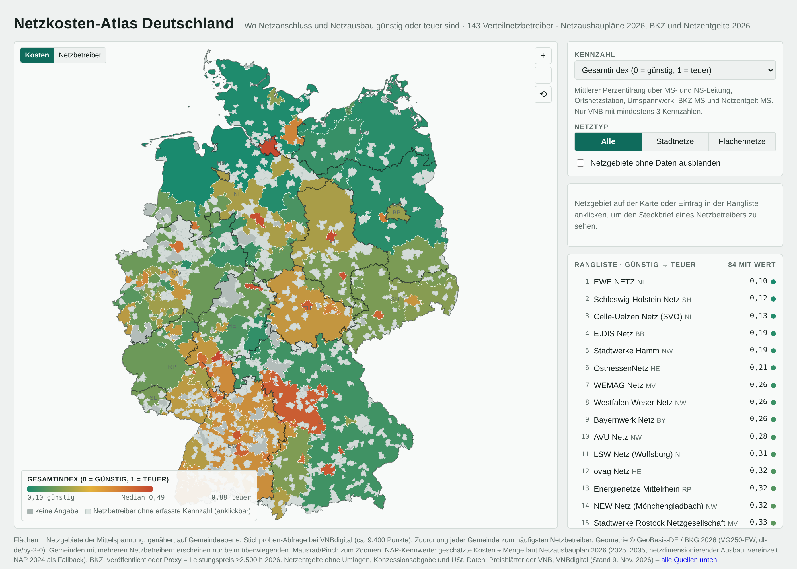

# Netzkosten-Atlas Deutschland

Wo sind Netzanschluss, Netzausbau und Netznutzung in Deutschland günstig, und wo teuer?
Der Atlas vergleicht die Verteilnetzbetreiber (VNB) mit öffentlich verfügbaren Daten:

- **Netzausbau-Kennwerte** aus den Netzausbauplänen 2026 (§ 14d EnWG, VNBdigital): €/m Leitung (HS, MS, NS), T€ je Ortsnetzstation, Mio. € je Umspannwerk
- **Baukostenzuschuss (BKZ)** Mittelspannung 2026: veröffentlicht oder, wo nicht veröffentlicht, Proxy über den Leistungspreis ≥ 2.500 h
- **Netzentgelte** 2026 (Jahresleistungspreissystem), dazu 2025 und 2027 (vorläufig), wo verfügbar
- **Entwicklungen**: Kostenansätze NAP 2024 → NAP 2026, geplanter Ausbaubedarf je Zeitraum, Netzentgelte 2025 → 2027

Die Karte zeigt die **Netzgebiete der Mittelspannung**, genähert auf Gemeindeebene.

## Benutzung

`index.html` herunterladen und im Browser öffnen. Die Datei enthält alle Daten und braucht nur eine Internetverbindung für die Bibliothek d3.js (cdnjs).

- Kennzahl oben rechts wählen, Netzgebiet oder Eintrag der Rangliste anklicken für den Steckbrief mit Quellen
- Mausrad bzw. Pinch zum Zoomen
- Unter der Karte: Entwicklungsgrafiken

Die Excel-Datei `Netzkosten_Auswertung_Deutschland.xlsx` enthält alle Rohdaten, Kennwerte, Rankings und Quellen mit Formeln.

## Inhalt

| Pfad | Inhalt |
|---|---|
| `index.html` | Interaktive Karte (eine Datei) |
| `Netzkosten_Auswertung_Deutschland.xlsx` | Auswertung mit Formeln, Rohdaten und Quellen |
| `data/vnb_kennwerte.csv` | Eine Zeile je VNB mit allen Kennzahlen |
| `data/nap_rohdaten.csv` | Mengen und Kosten aus den Netzausbauplänen 2026/2024 |
| `data/netzentgelte.csv` | LP/AP je Netzebene 2025, 2026, 2027 (vorläufig) mit Quelle |
| `data/bkz.csv` | Veröffentlichte Baukostenzuschüsse mit Quelle |
| `data/netzgebiete.geojson` | Netzgebiete (Mittelspannung), genähert auf Gemeindeebene |
| `data/gemeinde_vnb.csv` | Zuordnung Gemeinde → Netzbetreiber (Mittelspannung) |
| `src/` | Python-Skripte, mit denen Excel, Karte und Daten erzeugt werden |
| `METHODIK.md` | Berechnung, Annahmen und Grenzen |

## Grenzen

- Nicht alle rund 860 VNB sind erfasst, sondern die großen Flächen- und Stadtnetze (siehe `data/vnb_kennwerte.csv`). Gebiete anderer Netzbetreiber sind in der Karte hellgrau.
- Die NAP-Kennwerte sind Planwerte der Netzbetreiber, nicht abgerechnete Kosten, und je nach Netzbetreiber unterschiedlich abgegrenzt.
- Netzgebiete sind aus Stichproben abgeleitet. Gemeinden mit mehreren Netzbetreibern werden dem überwiegenden zugeordnet.
- BKZ-Proxy: Der veröffentlichte BKZ weicht im Einzelfall um den Faktor 0,5–1,4 vom Leistungspreis 2026 ab.

Details in [METHODIK.md](METHODIK.md). Korrekturen und fehlende Preisblätter gern als Issue oder Pull Request.

## Quellen und Lizenzen

- Netzausbaupläne: VNBdigital (www.vnbdigital.de), Dokumente der jeweiligen Netzbetreiber
- Netzentgelte und BKZ: Preisblätter der Netzbetreiber, je Wert verlinkt in Excel und Karte
- Netzgebiete: Zuordnung über Stichproben-Abfragen bei VNBdigital (Stand November 2026)
- Gemeinde- und Ländergrenzen: © GeoBasis-DE / BKG 2026, VG250-EW, Datenlizenz Deutschland – Namensnennung – Version 2.0 (dl-de/by-2-0), aufbereitet über [dimfalk/vg250](https://github.com/dimfalk/vg250)

Dieses Werk (Auswertung, Daten-Aufbereitung, Karte und Code) steht unter **CC BY-NC 4.0** ([LICENSE](LICENSE)): Nutzung, Weitergabe und Bearbeitung mit Namensnennung, nicht kommerziell. Die Geobasisdaten des BKG bleiben unter dl-de/by-2-0.

Autor: Daniel Maier · Keine Gewähr für Richtigkeit und Vollständigkeit. Maßgeblich sind die Preisblätter der Netzbetreiber.
